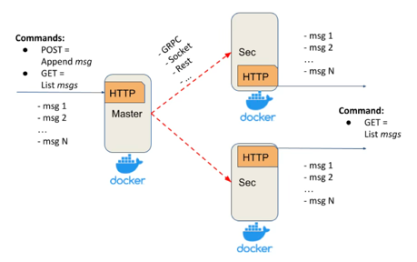
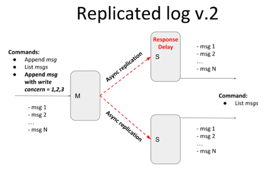

# Iteration 1.
10 points

The Replicated Log should have the following deployment architecture: one Master and any number of Secondaries.



**_Master_** should expose a simple HTTP server (or alternative service with a similar API) with:
- _POST method_ - appends a message to the in-memory list
- _GET method_ - returns all messages from the in-memory list

**_Secondary_** should expose a simple HTTP server (or alternative service with a similar API) with:
- _GET method_ - returns all replicated messages from the in-memory list

Properties and assumptions:
- after each POST request, the message should be replicated on every Secondary server
- Master should ensure that Secondaries have received a message via ACK
- Master’s POST request should be finished only after receiving ACKs from all Secondaries (blocking replication approach)
- to test that the replication is blocking, introduce a delay/sleep on the Secondary
- at this stage, assume that the communication channel is a perfect link (no failures and messages lost)
- any RPC framework can be used for Master-Secondary communication (Sockets, language-specific RPC, HTTP, Rest, gRPC, …)
- your implementation should support logging
- Master and Secondaries should run in Docker

**Testing**

To test the system behaviour under different network failures in a predictable manner, it is proposed to additionally implement a test harness.

It should allow simulating network failures programmatically and verifying the expected behaviour through integration tests.

In the current iteration, it should be tested that replication runs in parallel and that the master waits for ACKs from all secondaries.

Possible Harness test can be represented in the following way:

```text
transport = MockedTransport()
masterNode = MasterNode(transport)
secondaryNode1 = SecondaryNode(transport)
secondaryNode2 = SecondaryNode(transport)

transport.setDelay(masterNode, secondaryNode1, 5 sec)

masterNode.appendMsg("m1") <- should be blocked for 5 sec
masterNode.listMsgs() -> "m1"

transport.setDelay(masterNode, secondaryNode2, 6 sec)

masterNode.appendMsg("m2") <- should be blocked for 6 sec
masterNode.listMsgs() -> "m1", "m2"

transport.removeDelay(masterNode, secondaryNode1)
transport.removeDelay(masterNode, secondaryNode2)

masterNode.appendMsg("m3") <- no blocking

masterNode.listMsgs() -> "m1", "m2", "m3"
secondaryNode1.listMsgs() -> "m1", "m2", "m3"
secondaryNode2.listMsgs() -> "m1", "m2", "m3"
```

---

# Iteration 2.
20 points



In the previous iteration, the replication was blocking for all secondaries, i.e. to return a response to the client, we should receive acknowledgements (ACK) from all secondaries.

Current iteration should provide tunable semi-synchronicity for replication, by defining write concern parameters.

- client POST request in addition to the message should also contain write concern parameter `w=1,2,3,...,n`
- `w` value specifies how many ACKs the master should receive before responding to the client:
  - `w = 1` - only from master
  - `w = 2` - from master and one secondary
  - `w = 3` - from master and two secondaries

Add logic for messages to guarantee the total ordering of messages.

**Testing**

- Using Test harness emulate replicas' inconsistency (and eventual consistency) with the master by introducing an artificial delay on the secondary node. In this case, the master and secondary should temporarily return different messages lists.

**Acceptance test:**

1. Start M + S1 + S2 (delay 5-10 sec)
2. send (Msg1, W=1) - Ok
3. send (Msg2, W=2) - Ok
4. send (Msg3, W=3) - Wait because of S2 replication delay
5. send (Msg4, W=1) - Ok - should not be blocked by step 4 (the command may run in a different thread)
6. Check messages on S2 - [Msg1, (Msg2), (Msg3)]
7. Check messages on M|S1 - [Msg1, Msg2, Msg3, Msg4]

Introducing new method into Test harness to emulate messages reordering:

```text
transport = MockedTransport()
masterNode = MasterNode(transport)
secondaryNode1 = SecondaryNode(transport)
secondaryNode2 = SecondaryNode(transport)

transport.reorderMessages(
    masterNode,
    secondaryNode1,
    messages_count=2
) <- should wait for N (2 by default) messages and reorder them

masterNode.appendMsg("m1")
masterNode.appendMsg("m2")

secondaryNode1.listMsgs() -> "m1", "m2"
<- messages should be listed in a correct order
```

---

# Implementation

The implementation contains one Master and two Secondary nodes.

## Master

The Master:

- accepts new messages via `POST /messages`
- stores messages in memory
- assigns a monotonically increasing sequence number to every message
- replicates every message to all Secondary nodes in parallel
- uses `write_concern` to determine how many Secondary ACKs must be received before responding to the client
- allows multiple client requests to be processed concurrently

For the current configuration with two Secondaries:

- `write_concern=1` - does not wait for a Secondary ACK
- `write_concern=2` - waits for one Secondary ACK
- `write_concern=3` - waits for both Secondary ACKs

Replication is started for all Secondaries regardless of the selected write concern.

## Secondary

The Secondary nodes:

- receive replicated messages together with their sequence numbers
- store messages in memory using `SortedDict`
- maintain the last contiguous sequence number
- hide messages that arrive after a gap
- return visible messages via `GET /messages`

For example, if a Secondary receives:

```text
seq=1
seq=3
```

`seq=3` is stored but is not returned to the client because `seq=2` is missing.

After `seq=2` arrives, the Secondary returns:

```text
seq=1
seq=2
seq=3
```

This preserves total message ordering even when replication messages arrive out of order.

Master-to-Secondary communication is implemented over HTTP.

## Run with Docker

### 1. Start the system

```bash
docker compose up --build
```

Services:

- Master: http://127.0.0.1:8000
- Secondary 1: http://127.0.0.1:8001
- Secondary 2: http://127.0.0.1:8002

### 2. Send messages

Example with `write_concern=1`:

```bash
curl -X POST "http://127.0.0.1:8000/messages" \
  -H "Content-Type: application/json" \
  -d '{"message":"m1","write_concern":1}'
```

Example with `write_concern=2`:

```bash
curl -X POST "http://127.0.0.1:8000/messages" \
  -H "Content-Type: application/json" \
  -d '{"message":"m2","write_concern":2}'
```

Example with `write_concern=3`:

```bash
curl -X POST "http://127.0.0.1:8000/messages" \
  -H "Content-Type: application/json" \
  -d '{"message":"m3","write_concern":3}'
```

### 3. Read messages

```bash
curl "http://127.0.0.1:8000/messages"
curl "http://127.0.0.1:8001/messages"
curl "http://127.0.0.1:8002/messages"
```

## Artificial Delay

Secondary delays can be configured using environment variables.

For example:

```bash
docker compose down
S1_DELAY=0 S2_DELAY=5 docker compose up --build -d
```

With this configuration, Secondary 2 waits 5 seconds before processing every replicated message.

This can be used to observe temporary inconsistency between the Master and Secondary 2 and to verify different write concern levels.

Example with `write_concern=1`:

```bash
curl -X POST "http://127.0.0.1:8000/messages" \
  -H "Content-Type: application/json" \
  -d '{"message":"m1","write_concern":1}'
```
`{"status":"ok","time to response (s)":0.002}`


Example with `write_concern=2`:

```bash
curl -X POST "http://127.0.0.1:8000/messages" \
  -H "Content-Type: application/json" \
  -d '{"message":"m2","write_concern":2}'
```

`{"status":"ok","time to response (s)":0.017}`

Example with `write_concern=3`:

```bash
curl -X POST "http://127.0.0.1:8000/messages" \
  -H "Content-Type: application/json" \
  -d '{"message":"m3","write_concern":3}'
```

`{"status":"ok","time to response (s)":5.014}`

## Testing

### Mocked Test Harness

The mocked transport supports:

- artificial replication delays
- reordered message delivery

Run the mocked test harness in Docker:

`docker compose --profile test run --rm test`

Expected result: 
```text
All tests passed
```

The mocked tests verify:

- parallel replication
- waiting for the required number of ACKs
- `w=1` returning without waiting for Secondaries
- temporary inconsistency and eventual consistency
- correct visible order when messages are physically delivered out of order

### Acceptance Test

Start the system with Secondary 2 delayed by 5 seconds:

```bash
docker compose down
S1_DELAY=0 S2_DELAY=5 docker compose up --build -d
```

Run:

```bash
docker compose --profile acceptance run --rm acceptance
```

The acceptance test verifies the Iteration 2 scenario:

```text
Msg1, W=1 -> OK

Msg2, W=2 -> OK

Msg3, W=3 -> waits for delayed Secondary 2

Msg4, W=1 -> OK
             does not wait for Msg3
```

During the test, Secondary 2 can temporarily contain fewer visible messages than the Master and Secondary 1.

After replication completes, all nodes eventually contain:

```text
[Msg1, Msg2, Msg3, Msg4]
```

## Logging

View Docker logs:

```bash
docker compose logs master
docker compose logs secondary1
docker compose logs secondary2
```

Logs are also stored in the `logs/` directory, separately for the Master and each Secondary.

The logs include information about:

- received messages
- assigned sequence numbers
- write concern
- received ACKs
- artificial replication delays
- messages waiting because of sequence gaps
- reordered delivery in the mocked transport

## Stop the System

```bash
docker compose down
```